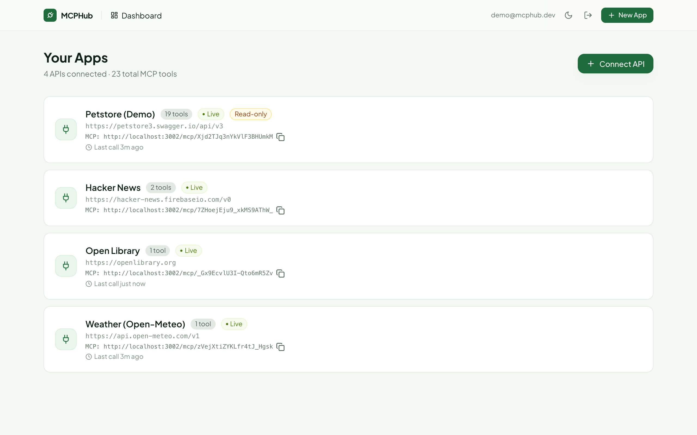
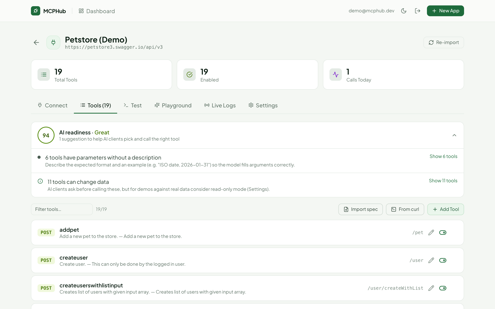
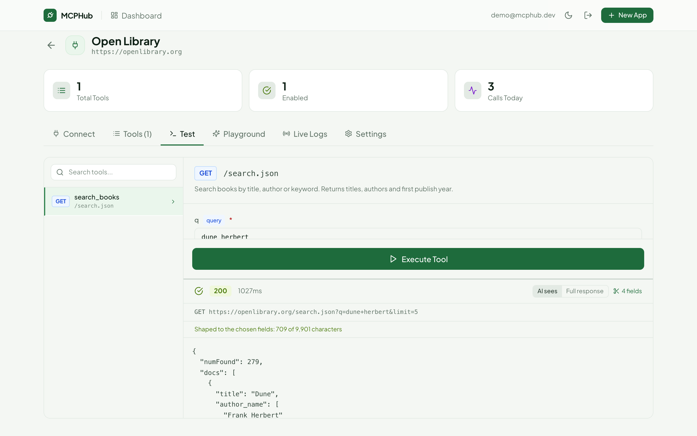
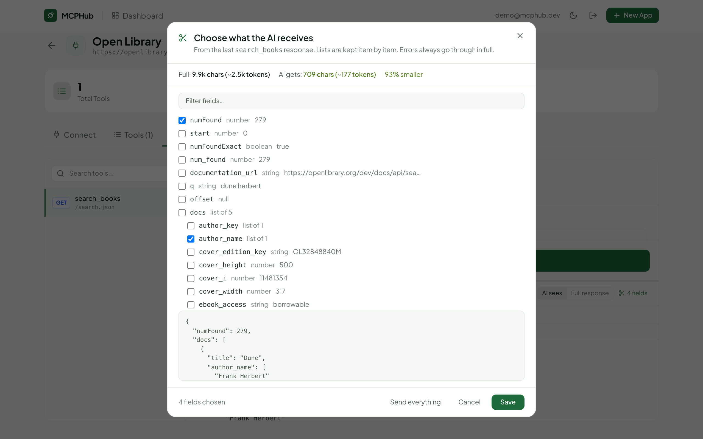
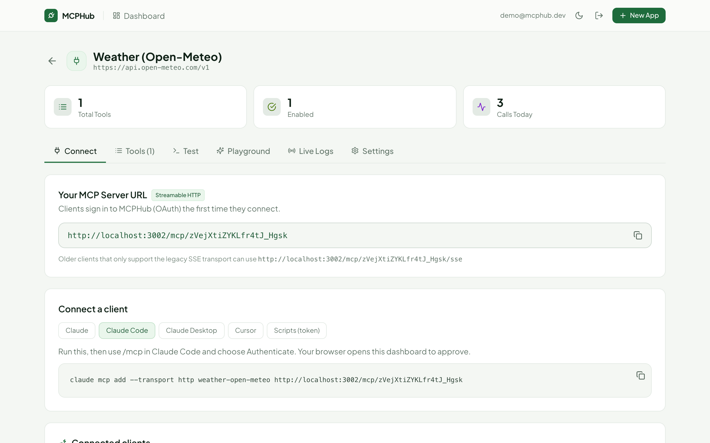
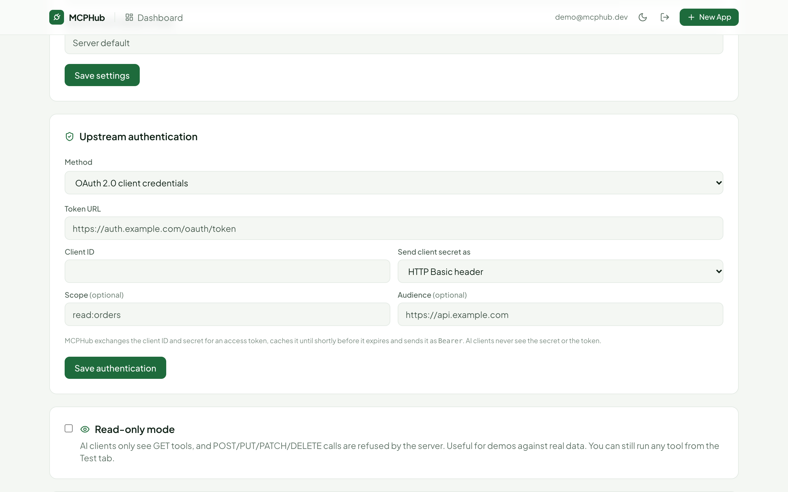
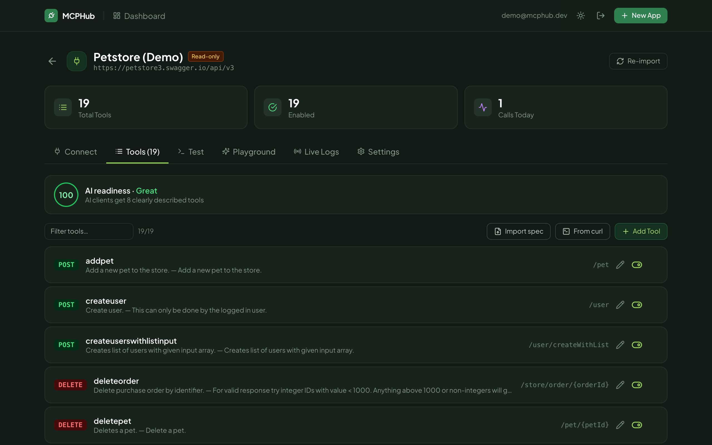
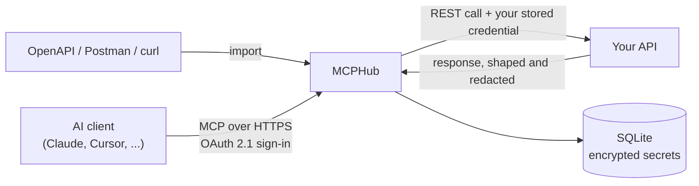

# MCPHub

**Turn any REST API into a hosted MCP server that Claude, Cursor and other AI clients can use.** Paste an
OpenAPI spec, a Postman collection or a single curl command. MCPHub turns it into tools and hosts them at an
MCP URL that asks for sign-in. Your API key stays encrypted on your server.



## Why

AI assistants talk to outside systems over the [Model Context Protocol](https://modelcontextprotocol.io)
(MCP). Most APIs are plain REST. To use one from Claude today, you write an MCP server for it, handle its
credentials, add sign-in for the AI client and host it. MCPHub does all of that for any REST API, so the work
becomes "import, review, connect."

## What it does

**Import**
- OpenAPI 3 specs (JSON or YAML, by URL or upload), Postman collections, or one curl command per tool.
- Every operation becomes an MCP tool with a JSON Schema built from its parameters and request body.
- **Config export/import** (`.mcphub.json`) moves an app between servers. The file never includes secrets.

**Make the tools good for an AI**
- **AI-readiness score.** Flags missing or vague descriptions, look-alike tools, undocumented parameters,
  write operations and oversized tool lists. Each finding links to the tools behind it.
- **Response shaping.** Pick the fields the AI receives from a real response; the picker shows the size
  saving before you save. In the screenshot below, an Open Library search goes from 9.9k characters to 709.
- **Read-only mode.** AI clients see only GET tools, and the server refuses write calls.
- MCP tool annotations (`readOnlyHint`, `destructiveHint`) let clients ask before a write.

**Connect**
- Streamable HTTP (plus legacy SSE) at `/mcp/<app-id>`, with an OAuth 2.1 authorization server built to
  the MCP spec (dynamic client registration, PKCE, resource indicators, rotating refresh tokens).
- Copy-paste setup for Claude, Claude Code, Claude Desktop and Cursor. Static API tokens for scripts.

**Upstream credentials**
- API key in a header or a query parameter, OAuth 2.0 client credentials (token cached and refreshed), and
  fixed headers or parameters that are sent on every call.
- Secrets are stored with AES-256-GCM, never returned by the API, and redacted from responses and logs. The
  AI never sees them.

**Operate**
- Test any tool from the dashboard and see exactly what the AI receives.
- Live logs, per-app rate limits and two-factor sign-in.
- Optional Claude playground: chat with your API through its tools.
- One-command backups and encryption-key rotation.

| | |
|---|---|
|  |  |
| **AI readiness**: what to fix so the model picks and calls the right tool. | **Response shaping**: the AI gets 709 characters instead of 9.9k. |
|  |  |
| **Field picker** built from a real response, with the size saving. | **Connect** with one command, or OAuth sign-in from any MCP client. |
|  |  |
| **Upstream auth**: API key, OAuth 2.0 client credentials, fixed params. | Light and dark themes. |

## How it works



On each tool call MCPHub:
1. Checks the caller's token and the app's rate limit.
2. Validates the arguments against the tool's schema.
3. Builds the request under the app's base URL, adding the credential and any fixed headers or parameters.
4. Sends it through an SSRF-guarded HTTP client (no private, loopback or metadata addresses, even after DNS
   changes or redirects).
5. Shapes and redacts the response, logs the call and returns the result to the client.

## Quick start (local)

Requires Node.js 22 or newer.

```bash
git clone https://github.com/moizafzal936/mcphub.git
cd mcphub
npm install
npm run dev
```

Open http://localhost:3000 and create the first account (in development the first account is created
from the sign-up page). Click **New App**, paste an OpenAPI URL such as
`https://petstore3.swagger.io/api/v3/openapi.json`, then copy the command from the **Connect** tab:

```bash
claude mcp add --transport http petstore http://localhost:3000/mcp/APP_ID
```

In Claude Code, run `/mcp` and choose **Authenticate**. Your browser opens MCPHub to approve the
connection.

The playground is off unless `ANTHROPIC_API_KEY` is set on the server (it bills per use).

## Deploy

[DEPLOY.md](DEPLOY.md) walks through a single-server deployment with Docker Compose, automatic HTTPS
(Caddy and Let's Encrypt) and nightly backups. It defaults to Oracle Cloud's Always Free tier with a free
`sslip.io` hostname, so it costs nothing. A Hetzner variant is included. In production, web sign-up is
closed and the first account is created from the server shell. That way nobody can claim a fresh
server before you do.

## Security

The full model and known gaps are in [SECURITY.md](SECURITY.md). Highlights:
- Passwords use scrypt; two-factor sign-in uses TOTP.
- Session tokens are stored only as hashes; requests are CSRF-checked.
- Every query is scoped to its owner.
- SSRF protection is applied at connect time.
- Secrets are encrypted and bound to their app.
- Production refuses to start with an unsafe configuration.

## Tests

```bash
npm test -w packages/server
```

98 tests run against a real server and database, with local stand-in APIs. They cover:
- authentication and cross-tenant isolation;
- CSRF and SSRF (IPv4/IPv6 forms, DNS rebinding, redirects);
- the MCP OAuth flow, token revocation and session limits;
- credential storage, redaction and key rotation;
- readiness scoring, response shaping, upstream OAuth;
- config import/export and backups.

## Tech stack

- **Server:** TypeScript, Node.js, Express, the official MCP TypeScript SDK, SQLite (libSQL), Ajv, Zod.
- **Dashboard:** React, Vite, Tailwind CSS.
- **Deploy:** Docker, Caddy.

## Limits

- **Single node.** Legacy SSE sessions and rate-limit counters live in memory. Run one instance.
- **Prompt injection.** Upstream responses go to the model. Read-only mode and write annotations reduce
  that risk, but no proxy can remove it.
- **No email.** There is no email verification or self-service password reset; operators reset passwords
  from the shell.
- **Needs a public HTTPS server for some clients.** Claude.ai and Claude Desktop custom connectors need
  one. Locally, use Claude Code.
- **Some APIs fit poorly.** APIs with very large surfaces, multi-step auth flows or business logic the AI
  must follow are often better served by an MCP server written for them.

## Status

A personal project, built to explore what it takes to make arbitrary APIs safe and usable for AI agents.
Issues and ideas are welcome.

## License

[MIT](LICENSE)
